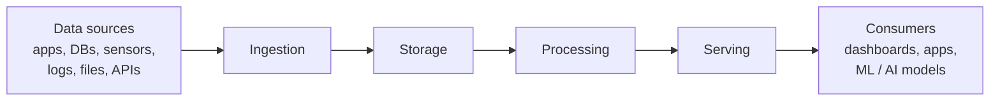

# Modern Data Architectures for Big Data I
## Lecture 1.2 — Big Data Primer

*Updated edition, October 2026*

---

## Agenda

1. **What is Big Data?** — Volume, Velocity, Variety, Veracity
2. **Why Big Data?** — IT evolution, BI evolution, data value
3. **Big Data use cases**
4. **Big Data inception** — the story of Hadoop
5. **The Big Data ecosystem** — ingestion, storage, processing, serving
6. **Big Data today (2026)** — lakehouses, streaming, cloud and AI
7. **Summary and further reading**

---

## 1. What Is Big Data?

> **Big data** is data that contains greater **variety**, arriving in increasing **volumes** and with ever-higher **velocity**. These are known as the **three Vs**.

| | Volume | Velocity | Variety |
|---|---|---|---|
| **Examples** | Terabytes, records, transactions, tables and files | Batch, near real time, real time, streams | Structured, semi-structured, unstructured, all of the above |

These characteristics make data intrinsically hard for any organization to handle, and many data initiatives still fail. The problem has shifted rather than disappeared: Gartner predicts that through 2026, organizations will **abandon 60% of AI projects that are not supported by "AI-ready" data**, and a 2024 Gartner survey found that 63% of organizations were not confident their data management practices were ready for AI.

The other big barrier is people: a shortage of skilled data and AI professionals remains one of the most frequently cited obstacles to data and AI success.

---

### 1.1 Volume

**Key question:** How do we capture and store massive amounts of data?

**Volume** refers to the amount of new data being generated.

**Comparative scale of bytes**

| Unit | Size | Rough intuition |
|---|---|---|
| Byte (B) | 1 byte | One character |
| Kilobyte (KB) | 1,000 B | A short page of text |
| Megabyte (MB) | 1,000 KB | A song (MP3) |
| Gigabyte (GB) | 1,000 MB | A movie |
| Terabyte (TB) | 1,000 GB | Thousands of books / a laptop drive |
| Petabyte (PB) | 1,000 TB | A large company's data warehouse |
| Exabyte (EB) | 1,000 PB | Roughly a day of the world's new data (see below) |
| Zettabyte (ZB) | 1,000 EB | The unit used to measure the global datasphere |
| Yottabyte (YB) | 1,000 ZB | Not yet reached by humanity's total yearly data |

**How much data is there?** The usual yardstick is IDC's *Global DataSphere*, which counts data created, captured, copied and consumed each year:

- **2010:** about 2 ZB per year
- **2023:** roughly 120–130 ZB
- **2025:** estimates range from about 175 to 200 ZB
- **2028:** IDC projects close to **400 ZB per year**

> **Note for discussion:** Published figures differ between sources (IDC, Statista, vendors) because they measure slightly different things. When you quote a big-data statistic, always check *who* measured it and *what* they counted — a good first lesson in veracity.

> *"We don't have better algorithms than anyone else. We just have more data."*
> — attributed to Peter Norvig, former Director of Research at Google

---

### 1.2 Velocity

**Key question:** How can we analyze and react to data generated at such rapid speeds?

**Velocity** refers to the speed at which data is created or updated — and how quickly it must be processed to be useful.

- Today the world creates **hundreds of millions of terabytes per day** (on the order of 0.4–0.5 ZB/day). At the original edition of this lecture, the commonly quoted figure was "more than 3 trillion GB (3 EB) per day", so the daily rate has grown by two orders of magnitude.
- The often-repeated claim that *"90% of the world's data was created in the last two years"* is a rule of thumb for exponential growth, not a precise measurement.
- IDC expected roughly **a quarter of all data to be real-time** by 2025, driven by IoT devices, sensors, mobile apps and online services.

Think of what happens in a single internet minute: messages sent, videos streamed, payments processed, sensor readings recorded. Fraud detection, ride-hailing, recommendations and logistics all depend on reacting to this data within seconds.

---

### 1.3 Variety

**Key question:** How do we capture and analyze different types of data together?

**Variety** refers to the number of formats and types of data:

| Type | Description | Examples |
|---|---|---|
| **Structured** | Fixed schema, rows and columns | Relational tables, transactions |
| **Semi-structured** | Self-describing, flexible schema | JSON, XML, logs, Parquet/Avro files |
| **Unstructured** | No predefined schema | Text, images, audio, video, PDFs |

Variety also refers to data coming from **many different sources**: sensors, phone calls, documents, video uploads, clickstreams, social media, and increasingly **embeddings** (vector representations of text and images used by AI systems).

---

### 1.4 Veracity

**Key question:** How do we know if data is accurate and trustworthy?

**Veracity** refers to the quality and trustworthiness of data. Because data comes from so many sources, it is difficult to link, match, cleanse and transform it consistently.

> *"More data beats clever algorithms, but better data beats more data."*
> — attributed to Peter Norvig

Veracity has become *more* important in the age of AI: machine learning models and large language models amplify whatever is in their training and input data, including errors and bias. This is why disciplines such as **data quality, data observability, data lineage and data governance** are now core parts of any data platform.

### The 4 Vs of Big Data

| V | Question it raises |
|---|---|
| **Volume** | How do we store it? |
| **Velocity** | How fast must we process it? |
| **Variety** | How do we combine different formats? |
| **Veracity** | Can we trust it? |

---

## 2. Why Big Data?

### 2.1 IT Evolution

We have used **relational databases** for decades, and they remain essential. But traditional, single-server relational databases have limitations for big data:

- Scaling up is limited and very expensive
- They are designed mainly for structured data
- Proprietary systems can lead to vendor lock-in

Meanwhile, year after year we have seen:

- Larger storage capacity and much faster storage (SSDs, NVMe)
- Lower cost per terabyte
- More powerful CPUs with more cores, plus **GPUs and AI accelerators**
- More memory (RAM) and much higher network bandwidth
- **Cloud computing**: technology democratization, pay-as-you-go pricing and no large upfront investment

> **2026 note:** Modern distributed SQL engines and cloud data warehouses have blurred the old line between "relational" and "big data". Many big data systems today speak SQL.

---

### 2.2 BI Evolution: From Business Intelligence to Advanced Analytics

Every company needs new analytical capabilities to remain competitive, for example:

- Handling any kind of data
- Analyzing data and acting on it in real time
- Scaling analytics as the business grows
- Predicting customer behavior
- Embedding AI into products and processes

#### Business Intelligence (BI)

> *Business intelligence (BI) is an umbrella term that includes the applications, infrastructure and tools, and best practices that enable access to and analysis of information to improve and optimize decisions and performance.* — Gartner

Traditional BI looks at **the past**:

- **What happened?** → Description → reporting
- **Why did it happen?** → Diagnosis → interactive dashboards

#### Advanced Analytics (AA)

> *Advanced analytics is the autonomous or semi-autonomous examination of data or content using sophisticated techniques and tools, typically beyond those of traditional BI, to discover deeper insights, make predictions, or generate recommendations.* — Gartner

Typical techniques: data and text mining, machine learning, pattern mining, forecasting, semantic and sentiment analysis, network and cluster analysis, multivariate statistics, deep neural networks and, more recently, **generative AI** (large language models).

Advanced analytics augments BI by looking at **the future**:

- **What may or will happen?** → Prediction → machine learning models
- **What should be done?** → Prescription → recommenders and optimization

#### The analytics value pyramid

| Level | Question | Typical tools | Business value / difficulty |
|---|---|---|---|
| **Prescriptive** | What should we do? | Recommenders, optimization, AI agents | Highest |
| **Predictive** | What will happen? | Machine learning, forecasting | High |
| **Diagnostic** | Why did it happen? | Drill-down, data exploration | Medium |
| **Descriptive** | What happened? | Reports, KPIs, dashboards | Foundational |

Moving up the pyramid shifts the focus from **hindsight** to **insight** to **foresight** — and requires more (and better) data.

---

### 2.3 Data Value

**Key question:** How can we make data valuable to our business?

**Value** refers to the worth of data, which depends directly on what an organization can do with it. When organizations derive insights and meaning from data, its value increases significantly. Adding value gives us the **5 Vs of Big Data**: Volume, Velocity, Variety, Veracity and **Value**.

#### Data is an asset

In 2017, *The Economist* argued that **the world's most valuable resource is no longer oil, but data**. Since then, entire business models have been built on data:

| Company | Paradox |
|---|---|
| Uber | One of the world's largest mobility companies owns almost no vehicles |
| Airbnb | One of the largest accommodation providers owns almost no real estate |
| Meta (Facebook, Instagram) | Among the most popular media platforms, yet creates almost none of the content |
| Netflix | A leading TV network that lays no cables |
| Alibaba | One of the most valuable retailers, with little inventory of its own |

All of them are **platforms whose core asset is data** about users, supply and demand.

#### The data value chain

Just like oil, raw data must be transported, stored and refined before it is useful:

| Oil value chain | Data value chain |
|---|---|
| Transportation | **Ingestion** — moving data from sources |
| Storage | **Storage** — keeping it reliably at scale |
| Refining | **Processing** — cleaning, transforming, analyzing |
| Consumption | **Serving** — delivering it to users, apps and models |



Throughout this course we will fill each stage of this chain with specific technologies.

---

## 3. Big Data Use Cases

Big data is used by virtually every digital company (Google, Amazon, Meta, Netflix, Spotify, Uber, Airbnb, Alibaba and many more) and increasingly by traditional industries.

| Industry | Typical use cases |
|---|---|
| **Banking & finance** | Fraud detection (online, card, insider), anti-money laundering, risk management, customer segmentation, personalized marketing |
| **Retail & e-commerce** | Product and cross-sell recommendations, dynamic pricing, demand and trend prediction, customer insights |
| **Manufacturing** | Predictive maintenance, demand forecasting, pricing, product quality monitoring, digital twins |
| **Telecommunications** | Churn prediction, personalized offers, network investment planning, new product development |
| **Social media & marketing** | Brand reputation, campaign analytics, sentiment analysis, influencer and competitor analysis |
| **Healthcare & life sciences** | Drug discovery, early diagnosis, genomics, insurance fraud detection |
| **Security** | Threat detection, cyberattack and DoS prediction, crisis response |
| **Public sector** | Smart cities, energy and water management, traffic and transportation, urban planning |
| **AI & software** | Training and grounding AI models, search, personalization |

> **Note:** In Europe, many of these use cases are shaped by regulation — GDPR for personal data, the EU AI Act for AI systems, and the EU Data Act (applicable since September 2025) for access to data generated by connected products.

### The most common use cases

Almost every company develops these two:

#### Data lake

A **data lake** is a centralized repository that lets you store all your structured and unstructured data at any scale. Data is stored *as-is*, without having to structure it first. The goal is to make all company data available for analysis.

Benefits of a data lake:

- Democratizes access to data
- Supports all data formats
- Schema flexibility ("schema-on-read")
- Enables advanced analytics and machine learning
- Scales cheaply on object storage
- Can improve data quality through a single, curated source

> **2026 update:** Poorly governed data lakes became "data swamps". Most organizations now build a **lakehouse** instead: a data lake with open table formats (such as Apache Iceberg or Delta Lake) that adds transactions, schema enforcement and governance, so the same data can serve BI dashboards and machine learning. We cover this in Section 6.

#### Customer analytics (360° customer view)

A **360° customer view** is a holistic customer profile that captures every relevant piece of information about a customer, creating a single picture across all lines of business: sales, service, marketing and more.

These insights help companies deliver personalized, engaging customer experiences and reach their performance objectives. Today they also feed real-time personalization engines and AI assistants.

---

## 4. Big Data Inception: The Story of Hadoop

| Year | Milestone |
|---|---|
| **2002** | Doug Cutting and Mike Cafarella start **Nutch**, an open-source web search engine. They soon realize it won't scale to index the whole web. |
| **2003** | Google, which already faced this problem, publishes the **Google File System (GFS)** paper. |
| **2004** | Google publishes the **MapReduce** paper, describing how it processes GFS files in parallel. Cutting and Cafarella see these ideas as the solution to their problem. |
| **2005** | Nutch implements its own MapReduce and a distributed file system, the **Nutch Distributed File System (NDFS)**. |
| **2006** | The work is split out of Nutch into a new project called **Hadoop**; NDFS is renamed **HDFS**. Doug Cutting joins **Yahoo!**, which gives the team the resources to evolve Hadoop to web scale. |
| **2008** | Hadoop becomes a **top-level Apache Software Foundation** project. |

Hadoop gave companies, for the first time with free and open-source software, the ability to **store and process huge amounts of data** on clusters of commodity machines.

### HDFS: Hadoop Distributed File System

Hadoop stores data in **HDFS**, a distributed, scalable file system that stores data in files and organizes them in directories.

- In a **local file system**, all files are stored on one single computer.
- In a **distributed file system**, files are split into blocks and stored across many computers (a **cluster**), with copies (replicas) for fault tolerance.

### Hadoop MapReduce

Because data is spread across many machines, we need a way to run **distributed applications** — programs that execute on many computers in parallel.

**Hadoop MapReduce** is a set of libraries and tools for writing such applications (called **jobs**). A job has two main phases:

1. **Map** — each machine processes its local chunk of data and emits key–value pairs
2. **Reduce** — pairs with the same key are grouped (the **shuffle**) and combined into a final result

**Example: word count**

```
Input:            "Rat Mat Cat" | "Mat Mat Cat" | "Rat Mat Rat"

Map:              (Rat,1)(Mat,1)(Cat,1) | (Mat,1)(Mat,1)(Cat,1) | (Rat,1)(Mat,1)(Rat,1)

Shuffle (group):  Rat → [1,1,1]    Mat → [1,1,1,1]    Cat → [1,1]

Reduce (sum):     Rat,3            Mat,4              Cat,2
```

> **2026 note:** Hadoop is still maintained (release 3.5.0 is current), but it is now considered a **legacy** architecture. Its ideas — distributed storage, data locality, parallel processing — live on in every modern platform. Understanding Hadoop is understanding *why* today's tools look the way they do.

---

## 5. The Big Data Ecosystem

From 2008, big data technology was freely available as open source for the first time. Other companies (Facebook, LinkedIn, Twitter, Netflix and others) started open-sourcing their own tools, and the community launched many projects around Hadoop.

The ecosystem emerged to fill gaps: Hadoop by itself provides only **storage and batch processing**, so it addresses mainly **volume** and **variety**. Most ecosystem tools fall into three areas:

### Data ingestion

**Data ingestion** is about capturing, collecting and moving data into the storage layer in a scalable and reliable way. Hadoop has no full-fledged ingestion component.

- *Legacy:* Apache Flume (logs), Apache Sqoop (relational databases)
- *Today:* **Apache Kafka** (event streaming, the de facto standard), Apache NiFi, change data capture tools such as Debezium, and managed cloud services

> Apache Sqoop has been retired to the Apache Attic, and Flume's last release (1.11.0) dates from 2022. They are worth knowing historically, not for new projects.

### Data processing

**Data processing** is about how data is computed, transformed and analyzed to extract its value. Hadoop's only built-in engine is MapReduce (batch processing), which has limitations:

- Difficult to program — not every problem fits neatly into map and reduce
- Mainly Java / JVM languages
- Batch only, with no streaming
- Writes intermediate results to disk, which is slow

Modern needs include **streaming, in-memory, SQL, graph and machine learning** processing. That is why other engines appeared — above all **Apache Spark**, which you will study in depth in the Spark sessions.

**Apache Spark components**

| Component | Purpose |
|---|---|
| Spark Core | Distributed in-memory engine |
| Spark SQL / DataFrames | Interactive and batch SQL |
| Structured Streaming | Real-time analytics |
| MLlib | Machine learning |
| GraphX | Graph processing |
| APIs | Python (PySpark), Scala, Java, R, SQL |

Spark is now in its 4.x series (4.2.0 released July 2026).

**Spark vs Hadoop MapReduce — the famous benchmark (Daytona GraySort, 2014)**

| | Hadoop MapReduce (2013 record) | Spark (2014 record) |
|---|---|---|
| Data sorted | 100 TB | 100 TB |
| Machines | 2,100 | 206 |
| Time | 72 minutes | 23 minutes |

Spark sorted the same data **3× faster with 10× fewer machines**.

Other important processing engines today include **Apache Flink** (low-latency stream processing, now in its 2.x series), **Trino/Presto** (distributed SQL) and cloud-native engines such as BigQuery, Snowflake and Databricks.

### Data serving

**Data serving** is about how processed data is delivered to end users and applications. Hadoop alone only stores data and runs batch jobs; it has no built-in way to query data interactively.

When the results are themselves big data, they are commonly served from:

- **NoSQL datastores** (e.g. Apache Cassandra, HBase, MongoDB) — covered next term
- **Search engines** (e.g. Elasticsearch, OpenSearch, Solr)
- **Cloud data warehouses and lakehouses** for analytics
- **Vector databases and vector search** for AI applications

### The legacy Hadoop ecosystem at a glance

| Layer | Typical legacy tools |
|---|---|
| Sources | Relational databases, files, logs, IoT devices, web and app events |
| Ingestion | Sqoop, Flume, Kafka, NiFi |
| Storage | HDFS (plus HBase) |
| Resource management | YARN |
| Processing | MapReduce, Hive (SQL), Pig (scripting), Spark, Storm (streaming), Mahout (ML) |
| Serving | HBase, Solr |
| Orchestration | Oozie, later Apache Airflow |
| Cluster management | Ambari, ZooKeeper |

---

## 6. Big Data Today (2026)

The big data ecosystem keeps evolving. These are the main shifts since the Hadoop era:

### From clusters to the cloud

Instead of buying and running Hadoop clusters, most organizations now use **managed cloud services**. The three hyperscalers dominate: in Q2 2026, Synergy Research estimated cloud infrastructure spending at about **$143 billion for the quarter (+43% year over year)**, with **AWS at 28%, Microsoft Azure at 20% and Google Cloud at 15%** market share. Growth is being driven heavily by AI workloads.

| Need | AWS | Azure | Google Cloud |
|---|---|---|---|
| Object storage (data lake) | S3 | Blob Storage / ADLS | Cloud Storage |
| Spark / Hadoop | EMR, Glue | HDInsight, Fabric, Databricks | Dataproc |
| Data warehouse | Redshift | Fabric / Synapse | BigQuery |
| Streaming | Kinesis, MSK | Event Hubs | Pub/Sub |

Independent platforms such as **Databricks** and **Snowflake** run on top of all three.

### Storage and compute separated

Hadoop kept data and computation on the same machines. Cloud platforms separate them: data sits cheaply in **object storage**, and compute engines scale up and down on demand.

### The lakehouse and open table formats

**Open table formats** — **Apache Iceberg**, **Delta Lake** and **Apache Hudi** — add database features (ACID transactions, schema evolution, time travel) on top of files in a data lake. This **lakehouse** architecture lets many engines (Spark, Flink, Trino, warehouses) share one copy of the data, reducing vendor lock-in.

### Streaming as a first-class citizen

Real-time pipelines are now mainstream. **Apache Kafka** 4.x has removed its dependency on ZooKeeper, and stream processors like Flink and Spark Structured Streaming make it possible to act on data within seconds.

### Organizational approaches: data mesh and data products

**Data mesh** proposes decentralized ownership: domain teams publish their data as well-documented **data products**, supported by a self-service platform and federated governance.

### Big data meets AI

Big data platforms are now the foundation of AI:

- Large language models are trained on massive datasets
- Companies ground AI assistants in their own data (retrieval-augmented generation, RAG) using **embeddings and vector search**
- **AI-ready data** — high-quality, governed, well-documented data — is now one of the main factors that decides whether AI projects succeed

---

## 7. Summary

- **Big data** is a consequence of the evolution of data, technology and business intelligence.
- It is characterized by the **5 Vs**: Volume, Velocity, Variety, Veracity and Value.
- Big data is a must-have capability because it enables **advanced analytics and AI**.
- There is a vast range of use cases in every industry; **data lakes/lakehouses** and **customer analytics** are the most common.
- Big data started with **Hadoop**, which was based on ideas published by Google (GFS and MapReduce). Hadoop provides both storage (HDFS) and processing (MapReduce).
- The **ecosystem** contains dozens of technologies for ingestion, processing and serving, and it is still evolving: Spark replaced MapReduce, Kafka became the standard for streaming, and cloud services replaced many self-managed clusters.
- The current trends are **cloud-native, lakehouse architectures with open table formats, real-time streaming, and data platforms built to feed AI**.

---

## Further Reading

**Foundational papers**
- [The Google File System (2003)](https://research.google/pubs/the-google-file-system/)
- [MapReduce: Simplified Data Processing on Large Clusters (2004)](https://research.google/pubs/mapreduce-simplified-data-processing-on-large-clusters/)

**History**
- [The history of Hadoop — Marko Bonaći](https://medium.com/@markobonaci/the-history-of-hadoop-68984a11704)

**Big data in practice**
- [Netflix Technology Blog](https://netflixtechblog.com/)
- [Spotify Engineering Blog](https://engineering.atspotify.com/)
- [Instagram knows what you're going to wear — Alto Analytics](https://www.alto-analytics.com/en_US/instagram-knows-what-youre-going-to-wear/)

**Data lakes, lakehouses and data mesh**
- [What is a data lake? — AWS](https://aws.amazon.com/what-is/data-lake/)
- [How Amazon is solving big-data challenges with data lakes — Werner Vogels](https://www.allthingsdistributed.com/2020/01/aws-datalake.html)
- [Lakehouse: A New Generation of Open Platforms (CIDR 2021)](https://www.cidrdb.org/cidr2021/papers/cidr2021_paper17.pdf)
- [Apache Iceberg](https://iceberg.apache.org/)
- [Data Mesh Principles and Logical Architecture — Zhamak Dehghani](https://martinfowler.com/articles/data-mesh-principles.html)

**Data and AI**
- [Lack of AI-Ready Data Puts AI Projects at Risk — Gartner (2025)](https://www.gartner.com/en/newsroom/press-releases/2025-02-26-lack-of-ai-ready-data-puts-ai-projects-at-risk)
- [The world's most valuable resource is no longer oil, but data — The Economist (2017)](https://www.economist.com/leaders/2017/05/06/the-worlds-most-valuable-resource-is-no-longer-oil-but-data)

---
