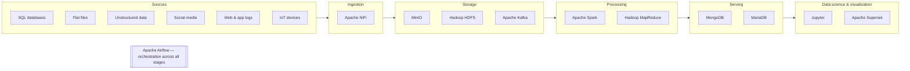

# Modern Data Architectures for Big Data I
## Lecture 2.1 — Course Environment

*Updated edition, October 2026*

---

## Agenda

1. **Jupyter notebooks** — the tool you will use in every lab
2. **The course environment** — the big data platform you will run on your laptop
3. **Installing OSBDET** — the VirtualBox journey and the UTM journey
4. **First steps with OSBDET** — the WebUI, Jupyter and validating your installation

---

## 1. Jupyter Notebooks

### What is a Jupyter notebook?

> An **open-source web application** that lets you **create and share documents** containing **live code**, **equations**, **visualizations** and **narrative text**.

A notebook is a sequence of **cells**:

| Cell type | What it holds | Example |
|---|---|---|
| **Markdown** | Text, headings, links, equations | `## Load the data` or `$E = mc^2$` |
| **Code** | Code that runs in a **kernel** (Python, Scala, R, SQL…) | `df = spark.read.csv("trips.csv")` |
| **Output** | Whatever the code returns, saved inside the notebook | Tables, charts, error messages |

```
┌─────────────────────────────────────────────────┐
│  trips_analysis.ipynb                  Python 3 │
├─────────────────────────────────────────────────┤
│  ## Average trip distance by hour               │  ← Markdown cell
├─────────────────────────────────────────────────┤
│  [3]: df.groupBy("hour").avg("distance").show() │  ← Code cell
│       ┌──────┬───────────────┐                  │
│       │ hour │ avg(distance) │                  │  ← Output
│       │  08  │     3.42      │                  │
│       └──────┴───────────────┘                  │
└─────────────────────────────────────────────────┘
```

The name **Jupyter** comes from three of its original languages: **Ju**lia, **Py**thon and **R**. Today kernels exist for dozens of languages.

> **2026 note:** Jupyter Notebook 7 is built on the same components as **JupyterLab**, the richer interface with file browser, terminals and multiple tabs. The same `.ipynb` files also open in VS Code and other editors.

---

### Why notebooks? Three key properties

#### 1. Open source

The source code is **freely available** and may be redistributed and modified.

**No license cost!**

#### 2. Web application

The only software an analyst needs is an **up-to-date web browser** (Chrome, Firefox, Safari, Edge…). The code runs on a server — in this course, inside the course environment.

**Makes onboarding new team members easier!**

#### 3. Create and share documents

In analytics you will share code **and** results more often than not. A notebook keeps the code, the outputs and the explanation together, so others can read it, rerun it and build on it.

**Collaboration is key to success!**

---

## 2. The Course Environment

### A playground, not a production cluster

- The course environment is a **playground for our labs and assignments**.
- It includes the **big data technologies companies use** in real projects…
- …but it is an **educational environment**, unable to cope with true big data workloads.
- The **transition** from the course environment to an **enterprise-class** platform should be **straightforward**: the concepts, APIs and tools are the same.

---

### Architecture of the course environment

The environment follows the same data value chain we saw in Lecture 1.2:



| Layer | Technology | What it does in the course |
|---|---|---|
| **Sources** | SQL databases, flat files, unstructured data, social media, web and app logs, IoT devices | Where the data comes from |
| **Ingestion** | **Apache NiFi** | Visual tool to collect, route and transform data flows |
| **Storage** | **MinIO** | Object storage with an S3-compatible API (like a data lake in the cloud) |
| | **Hadoop HDFS** | Distributed file system |
| | **Apache Kafka** | Event streaming platform: stores streams of events |
| **Processing** | **Apache Spark** | Distributed in-memory processing: batch, SQL, streaming, ML |
| | **Hadoop MapReduce** | The original batch processing engine (running on YARN) |
| **Serving** | **MongoDB** | NoSQL document database |
| | **MariaDB** | Relational (SQL) database |
| **Data science** | **Jupyter** | Notebooks for code, analysis and labs |
| **Visualization** | **Apache Superset** | Dashboards and data exploration |
| **Orchestration** | **Apache Airflow** | Schedules and coordinates pipelines across all layers |

---

### One "server" per technology

Conceptually, each technology runs as its own service, as if each one had its own server:

| | | | |
|---|---|---|---|
| **Jupyter** | **NiFi** | **MongoDB** | **Kafka** |
| **MariaDB** | **Airflow + Superset** | **Hadoop + MinIO** | **Spark** |

In a company these would be separate machines or clusters (or managed cloud services). In the course, they all live together on your laptop.

---

### Everything bundled in one virtual machine

All these technologies are **bundled together in a virtual machine (VM) image**, so you can run them on your own laptop.

```
┌──────────────────────── Your laptop ────────────────────────┐
│  ┌────────────── Virtual machine (OSBDET) ───────────────┐  │
│  │  Jupyter   NiFi       MongoDB          Kafka          │  │
│  │  MariaDB   Airflow    Hadoop (HDFS)    Spark          │  │
│  │            Superset   MinIO                           │  │
│  │  ──────────────── Linux (Debian) ──────────────────── │  │
│  └───────────────────────────────────────────────────────┘  │
│  ─────────── Hypervisor (e.g. VirtualBox, UTM) ──────────── │
│  ──────────── Host OS (Windows, macOS, Linux) ───────────── │
└─────────────────────────────────────────────────────────────┘
          ▲ you open the web UIs from your browser
```

> **Tip:** this is an undersized big data environment. **Start only the frameworks you need** for each lab and keep the rest stopped.

---

### OSBDET

**OSBDET** stands for **Open Source Big Data\* Educational Toolkit**. It consolidates many of the big data frameworks we teach at IE.

It is an open project available on GitHub: [github.com/raulmarinperez/osbdet](https://github.com/raulmarinperez/osbdet)

- It comes with no guarantees :)
- You are more than welcome to contribute
- It evolves over time to include more good stuff

The 2026 release builds environments for both **amd64** (Intel/AMD laptops) and **arm64** (e.g. Apple Silicon Macs).

*\* Big data in its purest, open-source form. Cloud and software vendors' offerings make big data adoption easier, but the underlying technologies are the same.*

---

### Accessing the web interfaces

Most tools have a web UI that you open from your browser. The OSBDET documentation lists this typical port mapping for virtual environments:

| Tool | Port inside the VM | Port on your laptop | Open in your browser |
|---|---|---|---|
| OSBDET WebUI | 2026 | 2026 | `http://localhost:2026` |
| Jupyter | 8888 | 28888 | `http://localhost:28888/lab` |
| HDFS UI | 50070 | 50070 | `http://localhost:50070` |
| YARN UI | 8088 | 28088 | `http://localhost:28088` |
| NiFi UI | 9090 | 29090 | `http://localhost:29090` |
| Spark UI | 4040 | 24040 | `http://localhost:24040` |
| Superset | 8880 | 28880 | `http://localhost:28880` |
| MinIO console | 9001 | 29001 | `http://localhost:29001` |
| SSH | 22 | 2222 | `ssh -p 2222 osbdet@localhost` |

> Your VM may be configured differently. Follow the setup instructions on Blackboard if they differ.

---

### From the course environment to the enterprise

The skills transfer directly, because enterprise platforms run the same technologies, usually as managed services:

| In the course | In a company (examples) |
|---|---|
| MinIO / HDFS | Amazon S3, Azure Data Lake Storage, Google Cloud Storage |
| Spark | Databricks, Amazon EMR, Google Dataproc, Microsoft Fabric |
| Kafka | Amazon MSK, Confluent Cloud, Azure Event Hubs |
| NiFi | Cloudera DataFlow, managed ingestion services |
| Airflow | Amazon MWAA, Google Cloud Composer, Astronomer |
| MongoDB / MariaDB | MongoDB Atlas, Amazon RDS for MariaDB, Azure Database for MySQL |
| Superset | Preset, or BI tools such as Power BI and Tableau |
| Jupyter | Databricks notebooks, SageMaker, Vertex AI Workbench |

---

### What's new in OSBDET's 2026 release

The latest OSBDET release (26r1) updates and extends the toolkit:

- **Updated versions:** Kafka 4, MongoDB 8, Hadoop 3.4, NiFi 2
- **New modules:** ClickHouse (analytical database), Grafana (monitoring dashboards), OpenMetadata (data catalog and governance), Kestra (orchestration), a truck fleet simulator (streaming data source) and a web control panel
- **Apple Silicon support:** arm64 builds alongside amd64

---

## 3. Installing OSBDET

### What you're installing: OSBDET 2026

| Layer | Technologies |
|---|---|
| Ingestion | NiFi |
| Storage | MinIO, HDFS, Kafka |
| Processing | Spark, MapReduce |
| Serving | MongoDB, MariaDB, **ClickHouse** (new) |
| Data science | Jupyter |
| Visualization | Superset, **Grafana** (new) |
| Across all stages | **Kestra** (orchestration), **OpenMetadata** (catalog and governance) |

### Which laptop do you have?

Laptops fall into two groups based on their processor. **Your laptop type decides which installation journey you follow.**

| Processor | Laptops | VM image |
|---|---|---|
| **Intel or AMD** | Windows laptops and older MacBooks (before 2021) | amd64 |
| **Apple Silicon** | New MacBooks: M1, M2, M3, M4 and all variants | arm64 |

**Mac users:** Apple menu → **About This Mac**. "Chip: Apple M…" means Apple Silicon; "Processor: Intel…" means Intel.

### Laptop minimum requirements

| | Requirement |
|---|---|
| **Processor** | Intel i5/i7 or AMD Ryzen 5/7 less than 4 years old, or Apple Silicon M1+ |
| **Memory** | 16 GB RAM (8 GB might work) |
| **Disk** | 500 GB disk with at least **50 GB free** |

> **Important:** make sure your laptop is compliant. Non-compliant laptops won't be ready for labs, and support will be best effort only.

### Choose your journey

```
                 Which processor does your laptop have?
                   ┌──────────────┴──────────────┐
              Intel / AMD                   Apple Silicon
                   ▼                              ▼
     3.1 The VirtualBox journey          3.2 The UTM journey
     OSBDET 2026r1 (amd64) · 9.63 GB     OSBDET'26r1.utm (arm64) · 10.77 GB
```

---

### 3.1 The VirtualBox journey

*Only Windows laptops and older Intel MacBooks. New MacBook? Follow 3.2.*

1. **Install VirtualBox** from the [official downloads page](https://www.virtualbox.org/wiki/Downloads) (tested on 7.2.4, Windows 11 and macOS).
2. **Download the OSBDET VM**: [OSBDET 2026r1 (amd64)](https://drive.google.com/file/d/1Nx_azqUg8x_gpPfw6RAuMUlVQGOJn9OE), 9.63 GB.
3. **Open VirtualBox Manager** and click **Import** (or **File → Import Appliance…**).
4. **Find and load** the downloaded `.ova` file.
5. Click **Finish**. The import takes a few minutes.
6. Your course environment appears in the list, **powered off** and ready.
7. *(Optional)* **Review the settings.** The defaults are enough; only change them if you know what you're doing. Stay within about **half** of your laptop's memory and cores.

**Start up:** right-click OSBDET → **Start** → **Start without GUI** (recommended; you'll work from the browser).

**Shut down:** right-click OSBDET → **Stop** → **Shut Down**. Always stop it when you're done; otherwise your laptop slows down and the environment may get corrupted.

**Troubleshooting**

| Error | Likely cause | Fix |
|---|---|---|
| `NS_ERROR_INVALID_ARG` (importing) | Not enough disk space | Free up 15–20 GB and import again |
| | Download incomplete or corrupted | Download the VM again |
| | Other causes | [VirtualBox failed to import appliance: top 4 causes and fixes](https://bobcares.com/blog/virtualbox-failed-to-import-appliance/) |
| `NS_ERROR_FAILURE` (MacBook) | macOS blocked VirtualBox | **System Settings → Privacy & Security** (Security & Privacy on older macOS), click **Allow**, reboot when asked |

---

### 3.2 The UTM journey

*Only new MacBooks with Apple Silicon. Windows or Intel Mac? Follow 3.1.*

1. **Install UTM 4.7.4**: [download UTM.dmg](https://github.com/utmapp/UTM/releases/download/v4.7.4/UTM.dmg) and drag UTM to Applications.
2. **Download the OSBDET VM**: [OSBDET'26r1.utm.zip (arm64)](https://drive.google.com/file/d/1umrx-hAGLxKt-cJ3zVJTKQ41zlEomIn4/view?usp=sharing), 10.77 GB.
3. **Uncompress** `OSBDET'26r1.utm.zip` to get `OSBDET'26r1.utm`.
4. **Move** `OSBDET'26r1.utm` to its final place (e.g. Documents).
5. In UTM: **File → Open…**, select `OSBDET'26r1.utm` and click **Open**.
6. Your course environment appears in UTM's sidebar, ready to use.

```
OSBDET'26r1.utm.zip ──uncompress──► OSBDET'26r1.utm ──move──► Documents ──File → Open──► UTM
```

**Start up:** press **Play ▶**. Two console windows open: **minimize both**, you won't need them.

**Shut down:** use the **power button** at the top right of OSBDET's WebUI (see below).

---

## 4. First Steps with OSBDET

### OSBDET's WebUI, your friend

Open **[http://localhost:2026](http://localhost:2026/)** in your laptop's browser. The welcome page lets you:

- **Click the boxes** to learn what each tool does and how to use it
- **Turn tools on and off** (avoid running more than two technologies at once)
- **Turn the environment off** with the power button

### Use OSBDET's Jupyter, not yours

OSBDET includes **its own Jupyter**, with access to the big data technologies. It is different from any Jupyter you may already have installed.

| URL | What it is | Use it? |
|---|---|---|
| `http://localhost:8888` | Your own Jupyter, installed on your laptop | ✗ Not for this course |
| **`http://localhost:28888/lab`** | **OSBDET's Jupyter**, inside the VM (port 8888), with Spark, Kafka, HDFS… | ✓ Use this one |

Turn Jupyter on in the WebUI, open `http://localhost:28888/lab` and use the password **`osbdet123$`**.

### Validate your installation

1. **Start the VM** — VirtualBox: *Start without GUI* · UTM: *Play*
2. **Open the WebUI** — `localhost:2026` shows the welcome page
3. **Turn Jupyter on** — flip its switch in the WebUI
4. **Log in to Jupyter** — `localhost:28888/lab` with `osbdet123$`
5. **Run a cell** — create a notebook and run `print("Hello, OSBDET")`
6. **Shut down properly** — VirtualBox: *Shut Down* · UTM: WebUI power button

**Be curious and explore:** we'll use most of these technologies throughout the labs.

**Congrats, you're ready!**

---

## Questions?

**Next:** your first lab in OSBDET

---

